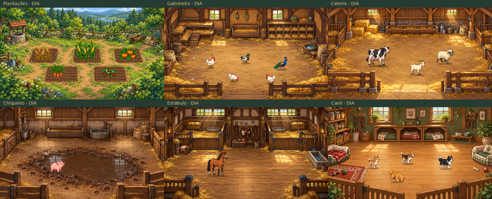
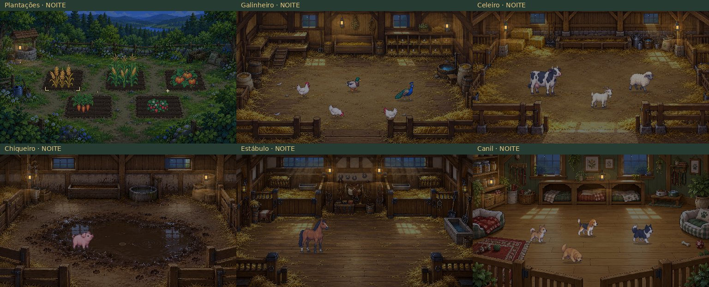

# IdleFarm · um canto para cultivar

Jogo incremental de fazenda para desktop, em **Python 3.12 + PySide6**.
Cinco culturas, cinco instalações, doze espécies/raças, seis ambientes originais
em pixel art, ciclo de luz local, progresso offline e salvamento persistente.
O jogo funciona sem internet.




## Jogar no Windows

O workflow [Windows x64](.github/workflows/windows-release.yml) gera
`IdleFarm.exe` e, para tags de versão, publica o arquivo e `SHA256SUMS.txt` na
aba [Releases](https://github.com/BernardoJ/IdleFarm/releases).
Uma release só é criada após testes, build e duas inicializações do próprio
executável no Windows. A existência deste código não comprova que o workflow
já executou: confira a execução em [Actions](https://github.com/BernardoJ/IdleFarm/actions).

Quando a release estiver disponível, baixe o executável, salve em qualquer
pasta e abra com dois cliques. Não precisa instalar Python. O save fica em
`%APPDATA%\IdleFarm\save.json`; mover o executável não move nem apaga o progresso.
O executável não tem assinatura de código nesta versão.

## Começar sua fazenda

- Você começa com **50 moedas e dois terrenos**. Selecione um terreno, escolha
  trigo ou cenoura e clique em **Plantar**. Ao amadurecer, clique em **Colher**.
- Milho, morango e abóbora desbloqueiam com receita acumulada, sem gastar moedas
  no desbloqueio. A colheita permanece manual, mesmo depois de vários dias fora.
- Compre terrenos e construa instalações pelas seis abas. Cada terreno funciona
  de verdade; cada animal produtivo tem seu próprio ciclo de pagamento.
- O preço de novas unidades da mesma espécie sobe 12%. Isso incentiva diversificar
  a fazenda, sem limitar o número de animais. As expansões sobem 35%.
- Cachorros são companheiros: **não produzem moedas**.
- Animais produzem durante toda a sessão; ao reabrir, a produção monetária conta
  até **quatro horas**. O crescimento de plantações conta todo o tempo real.
- A cena mostra até **cinco representantes**, priorizando culturas e espécies
  diferentes. Esse limite não afeta produção, propriedade nem salvamento.
- Arraste a cena ou a barra da janela para movê-la. **Sempre no topo** é opcional;
  **Ocultar gerenciamento** reduz a janela para acompanhar a fazenda enquanto trabalha.
- Sem dinheiro para trigo, sem plantações e sem animais produtivos, o botão
  **Sementes de recomeço** garante uma retomada sem bloquear a progressão.

[Tabela econômica completa e análise de retorno](docs/ECONOMIA.md).

## Executar pelo código

```powershell
py -3.12 -m venv .venv
.venv\Scripts\python.exe -m pip install -r requirements.txt
.venv\Scripts\python.exe main.py
```

Em Linux/macOS, use `python3 -m venv .venv` e `.venv/bin/python`.
Para um perfil de teste: `python main.py --save caminho/temporario/save.json`.
A variável `IDLEFARM_SAVE_PATH` também permite selecionar um perfil. Não altere
o relógio do computador para testar: os testes usam um relógio virtual isolado.

## Validar e recompilar

```powershell
python -m pip install -r requirements-dev.txt
python -m ruff check .
python -m ruff format --check .
python -m pytest -q
python tools/validate.py --output qa-output/visual
```

Em um servidor Linux sem tela, defina `QT_QPA_PLATFORM=offscreen`. A aplicação
também possui um smoke test que exige um perfil isolado:

```powershell
python main.py --save qa-output/profile/save.json --smoke qa-output/source.json
```

No Windows, execute `build_windows.bat`. O script instala dependências, roda
os testes, gera `dist/IdleFarm.exe`, inicia o executável em uma pasta temporária
duas vezes e grava seu SHA-256. Alternativamente:

```powershell
python -m PyInstaller --noconfirm --clean IdleFarm.spec
python tools/smoke_exe.py dist/IdleFarm.exe --output qa-output/packaged
```

O PyInstaller gera binários nativos: em Linux, a saída é Linux. O executável
Windows x64 deve ser gerado no Windows ou pelo workflow Windows incluído.
Para publicar uma versão, envie uma tag, por exemplo `v0.1.0`; a publicação é
automática somente se todos os passos do workflow passarem.

## Arquitetura e persistência

| Diretório | Responsabilidade |
|---|---|
| `game/` | Economia, plantações, produção por animal, transações e salvamento |
| `config/catalog.json` | Todos os preços, tempos, recompensas e desbloqueios |
| `ui/` | Controles Qt, navegação, notificações e preferências |
| `visual/` | Cenas 256×144, animação, limite visual e iluminação |
| `assets/` | Arte original pronta para uso offline e ícone Windows |
| `tools/` | Simulação, capturas, geração de arte e smoke test de distribuição |
| `tests/` | Testes econômicos, integração, recuperação e interface |

O save é JSON versionado, validado antes de carregar. Gravações usam arquivo
temporário, `fsync` e substituição atômica, com cópia `.bak`. Arquivos ilegíveis
são preservados como `.corrupt-*`, com recuperação da cópia válida e aviso.
Uma trava por perfil evita duas janelas contabilizando a mesma fazenda.
Timestamps de alta-maré impedem voltar o relógio e receber novamente ciclos
já pagos. Não há DRM nem proteção criptográfica contra edição manual do save.

Leia [os testes e limites verificados](docs/VALIDACAO.md) e
[a direção artística](assets/ART_DIRECTION.md). A referência de apresentação
foi o [PescaIdle](https://github.com/BernardoJ/PescaIdle), consultado sem alterações.
